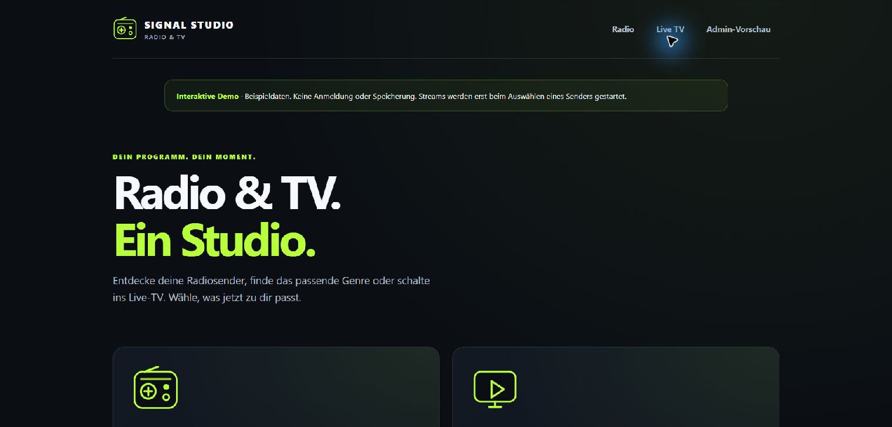
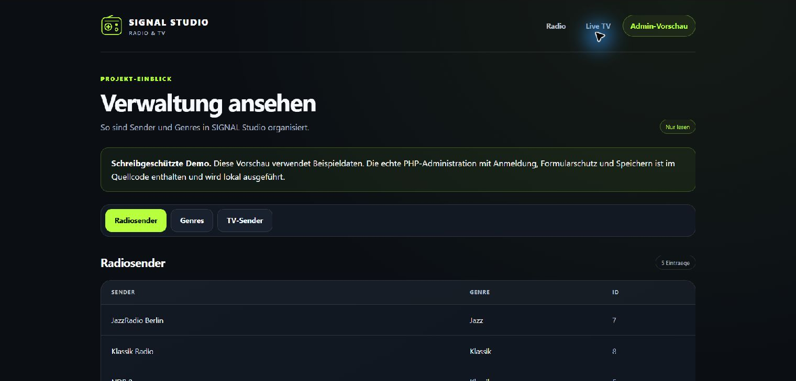

# SIGNAL Studio — Radio & TV

Persönliches Lernprojekt im Rahmen meiner Umschulung zum Fachinformatiker für Anwendungsentwicklung bei CBW. Eine Webanwendung zum Radiohören und Fernsehen mit einer gemeinsamen PHP-Verwaltung.

**Technologien:** PHP · MySQL/MariaDB · JavaScript · HTML · CSS · HLS.js · WordPress-Shortcode



## Interaktive Vorschau

Das Repository enthält eine statische Demo mit Radio-Player, TV-Player und einer schreibgeschützten Verwaltungsansicht. Sie lässt sich mit GitHub Pages veröffentlichen. Die Einrichtung steht in [GitHub Pages aktivieren](docs/GITHUB-PAGES.md). Der öffentliche Link funktioniert erst nach dem Hochladen und dem erfolgreichen Pages-Deployment.

Die Demo verwendet JSON-Beispieldaten. Anmeldung und Datenbankänderungen gehören zur lokal installierten PHP-Vollversion. Live-Streams benötigen eine Internetverbindung; ihre Verfügbarkeit hängt vom jeweiligen Anbieter und Browser ab.



## Was ich dabei übe

- Datenbankabfragen mit PDO und vorbereiteten SQL-Anweisungen
- JSON-Endpunkte und asynchrones Laden im Browser
- Sitzungsbasierte Anmeldung, Eingabeprüfung und CSRF-Schutz
- Gemeinsame Gestaltung für Player und Administration

## Funktionen

- Radio-Player als eigenstaendige HTML-Seite und als WordPress-Shortcode `[easy_radio]`
- Genre-Auswahl und mehrere unabhaengige Radio-Player auf einer Seite
- TV-Player mit HLS/MP4-Unterstuetzung
- Startlautstaerke 10 Prozent; Wiedergabe durch Benutzerinteraktion
- Gemeinsamer, geschuetzter Admin-Zugang fuer Radio- und TV-Verwaltung
- Erstellen, Bearbeiten und Loeschen von Sendern und Genres
- Oeffentliche, lesende JSON-Endpunkte fuer die Player

## Lokale Installation

Voraussetzungen: Apache, PHP 8.2 mit PDO MySQL und mbstring sowie MySQL/MariaDB, beispielsweise aus XAMPP.

1. Projekt nach `htdocs/radio_projekt` kopieren.
2. **Nur bei einer neuen Installation:** `database/schema.sql` importieren. Fuer Beispielsender danach optional `database/seed.sql` in eine leere Datenbank importieren. Standardname: `myradio`. Vorhandene Installationen benoetigen keinen erneuten Import; ihre Tabellen und Sender bleiben bestehen.
3. `lib/config.example.php` nach `lib/config.local.php` kopieren und Datenbankdaten lokal anpassen. Die lokale Datei nie veroeffentlichen. Alternativ die entsprechenden Umgebungsvariablen setzen.
4. Startseite: `http://localhost/radio_projekt/`. Radio: `http://localhost/radio_projekt/easy-radio/player.html`
5. TV: `http://localhost/radio_projekt/tv-player/player.html`

Die Datenbankverbindung verwendet eine feste Konfiguration statt einer Auswahl anhand des HTTP-Host-Headers. Fuer Hosting eigene Zugangsdaten in der lokalen Konfiguration setzen; keine Kennwoerter in den Quelltext eintragen.

## Admin-Zugang einrichten

Im Projektordner ausfuehren:

```powershell
C:\xampp\php\php.exe scripts\configure-admin.php
```

Das Skript fragt einen Benutzernamen und ein Passwort mit 12 bis 72 Zeichen ab. Die Eingabe ist im Terminal sichtbar; gespeichert wird nur ein Passwort-Hash. Ohne eingerichteten Hash bleibt die Administration gesperrt. Es gibt kein Standardkennwort.

Anmeldung: `http://localhost/radio_projekt/admin/login.php`. Danach sind Radio- und TV-Verwaltung ueber dieselbe Sitzung erreichbar. Admin-Formulare verwenden CSRF-Tokens. Loeschvorgaenge akzeptieren nur POST; ein verwendetes Radio-Genre kann nicht geloescht werden.

Die gemeinsamen Verzeichnisse `lib`, `database`, `scripts`, `tests` und `backups` sind unter Apache gegen direkten HTTP-Zugriff geschuetzt. `AllowOverride` muss fuer `.htaccess` aktiviert sein. Der eingebaute PHP-Entwicklungsserver wertet `.htaccess` nicht aus und dient hier nur automatisierten lokalen Tests.

## WordPress

Den Ordner `easy-radio` zusaetzlich nach `wp-content/plugins/easy-radio` kopieren, das Plugin aktivieren und `[easy_radio]` auf einer Seite einsetzen. Die JSON-Endpunkte und ihre Datenbank verbleiben standardmaessig unter `/radio_projekt/` auf demselben Host. Die kopierten Plugin-Dateien muessen bei einer Aktualisierung ebenfalls ersetzt werden.

Ein abweichender Backend-Pfad kann ueber den WordPress-Filter `signal_radio_api_base_url` konfiguriert werden. Fuer eine andere Domain sind zusaetzlich passende CORS-Regeln notwendig; standardmaessig wird derselbe Ursprung verwendet.

Details zu den iframe-Beispielen: `WORDPRESS-EINBINDUNG.txt`.

## Automatisierte Pruefung

```powershell
python -B tests/test_app.py
```

Benoetigt Python 3.11+, PHP und die installierten XAMPP-MariaDB-Binaerdateien. Standardpfade sind `C:\xampp\php\php.exe` und `C:\xampp\mysql\bin`; abweichende Pfade ueber `PHP_BINARY` und `MYSQL_BIN` setzen.

Die Tests starten eine temporaere MariaDB-Instanz auf einem freien lokalen Port mit eigenen Tabellen, Sessions und Test-Zugangsdaten. Die normale XAMPP-Datenbank wird nicht verwendet oder veraendert. Testdaten werden anschliessend entfernt. Geprueft werden oeffentliche APIs, Admin-Zugriffsschutz, CSRF, Login/Logout und CRUD fuer Radio, Genres und TV. Echte Audio-/Videowiedergabe und eine vollstaendige WordPress-Installation sind separate Browserpruefungen.

## Grenzen

Live-Stream-Adressen koennen sich aendern; CORS, Geoblocking, Codec-Unterstuetzung und Autoplay-Regeln beeinflussen die Wiedergabe. Die Anwendung ist ein lokales Lernprojekt und keine vollstaendig gehaertete oeffentliche Streamingplattform. Hinweise zu HLS.js und externen Medien stehen in [THIRD-PARTY.md](docs/THIRD-PARTY.md). Eine WordPress-Installation wurde nicht separat im Browser geprüft.

## Gemeinsame Gestaltung

Startseite, eigenstaendige Player und Administration verwenden das SIGNAL-Studio-Design mit dunklen Oberflaechen, hellgruener Akzentfarbe und gemeinsamer Navigation. Die Basis liegt in assets/css/studio.css; die Player behalten zusaetzlich ihre gekapselten Komponenten-Styles, damit WordPress-Seiten nicht global umgestaltet werden. Tabellen bleiben auf kleinen Bildschirmen innerhalb ihres Containers scrollbar.

## Statische Demo lokal ansehen

```powershell
python scripts/build_demo.py
python tests/check_demo.py
python -m http.server 8080 --directory demo
```

Danach `http://localhost:8080/` öffnen. Nur der Ordner `demo` wird von GitHub Pages veröffentlicht. Der Workflow liegt unter `.github/workflows/pages.yml`.
